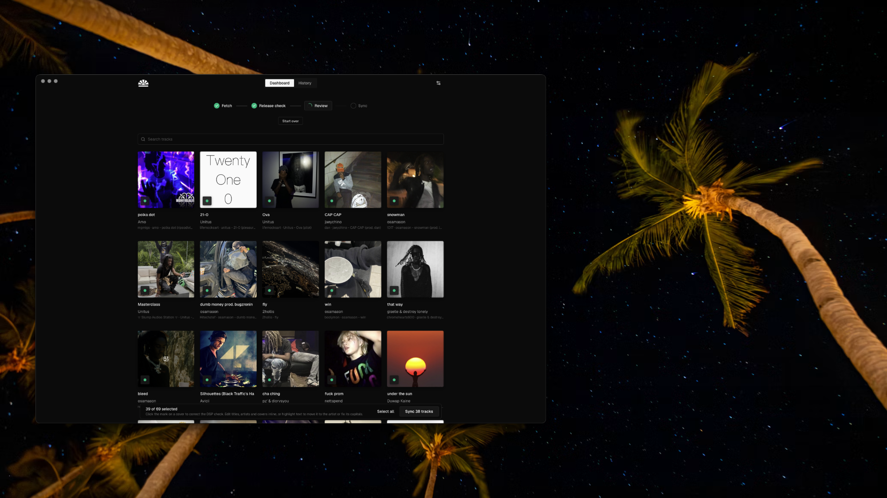

<div align="center">


# palms

**local files the easy way 😎**

[download](https://github.com/isaacdewam/palms/releases/tag/v0.1.0)
</div>



## Prerequisites

- `./scripts/fetch-binaries.sh` (downloads the yt-dlp and ffmpeg bundled into the app)
- Rust (rustup) and pnpm

## Run

```
pnpm install
pnpm tauri dev
```
